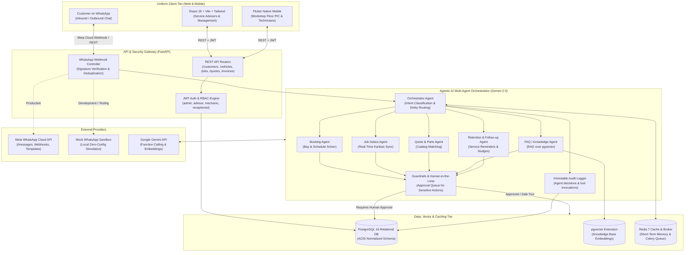

# SmartCRM - Enterprise Automotive Workshop CRM & Agentic AI Architecture

## 1. Executive Summary & Product Vision

**SmartCRM** is a next-generation Customer Relationship Management and Operations platform engineered specifically for automotive repair workshops (operating at a scale of 4 to 8 active service bays and 5 to 10 mechanics). 

The platform bridges real-time workshop floor execution with autonomous customer engagement by embedding an **Agentic Multi-Agent AI Assistant** that operates directly over WhatsApp. Customers interact using natural, multilingual conversations (English, Bahasa Melayu, and local automotive terminology / Manglish), while workshop technicians and service advisors maintain complete operational oversight through synchronized **Web** and **Mobile** interfaces adhering to a **uniform dark automotive design system**.

---

## 2. End-to-End System Architecture



---

## 3. High-Level Modular Folder Structure

```
SmartCRM/
├── .env.example                     # Environment template with WhatsApp, Gemini & Redis
├── docker-compose.yml               # Production & local orchestrator (PostgreSQL, Redis, Celery, App)
├── ARCHITECTURE.md                  # This document
│
├── backend/
│   ├── Dockerfile
│   ├── requirements.txt             # Python 3.11+ dependencies
│   ├── alembic.ini                  # Migration configuration
│   ├── alembic/                     # Database version history
│   │   ├── env.py
│   │   └── versions/
│   │
│   ├── app/
│   │   ├── main.py                  # FastAPI application entrypoint & OpenAPI specs
│   │   │
│   │   ├── core/                    # Core infrastructural singletons
│   │   │   ├── config.py            # Pydantic v2 settings & environment binding
│   │   │   ├── security.py          # Password hashing, JWT creation & token decode
│   │   │   ├── database.py          # SQLAlchemy 2.x sessionmaker & engine setup
│   │   │   ├── celery_app.py        # Asynchronous background task scheduler
│   │   │   └── guardrails.py        # Role permission checks, input/output sanitizers
│   │   │
│   │   ├── models/                  # SQLAlchemy 2.0 ORM Entities (Base declarative)
│   │   │   ├── user.py              # Staff credentials & RBAC roles
│   │   │   ├── customer.py          # Customer profiles & WhatsApp numbers
│   │   │   ├── vehicle.py           # Multi-vehicle linking & odometer logs
│   │   │   ├── appointment.py       # Bay scheduling & time slots
│   │   │   ├── job_card.py          # Kanban stages, tasks, photos & mechanic assignment
│   │   │   ├── part.py              # Inventory, stock threshold alerts & supplier POs
│   │   │   ├── quote.py             # Estimates, itemized labor & approval state
│   │   │   ├── invoice.py           # Invoices, tax (SST), and payment receipts
│   │   │   ├── whatsapp.py          # Inbound/outbound message log & template records
│   │   │   ├── approval.py          # Human-in-the-loop pending approval queue
│   │   │   ├── knowledge.py         # Knowledge base articles with pgvector embeddings
│   │   │   └── audit.py             # Immutable audit trails of all agent actions
│   │   │
│   │   ├── schemas/                 # Pydantic v2 validation models
│   │   ├── repositories/            # Data access layer (abstracted SQL queries)
│   │   ├── services/                # Business logic services (Billing, JobFlow, Parts)
│   │   │
│   │   ├── agents/                  # Multi-agent system (Gemini Function Calling)
│   │   │   ├── orchestrator.py      # Classifier, router, and context coordinator
│   │   │   ├── booking_agent.py     # Appointment slot proposing and booking
│   │   │   ├── job_status_agent.py  # Stage inquiry & proactive ready alerts
│   │   │   ├── quote_agent.py       # Estimate drafting & service catalog matching
│   │   │   ├── faq_agent.py         # RAG retrieval over workshop policies
│   │   │   └── followup_agent.py    # Service-due nudges & post-repair satisfaction
│   │   │
│   │   ├── tools/                   # Typed Python tools for AI function calling
│   │   │   ├── registry.py          # Tool decorator, JSON schema exporter & dispatcher
│   │   │   ├── customer_tools.py    # lookup_customer, create_lead
│   │   │   ├── vehicle_tools.py     # get_vehicle_history, check_mileage
│   │   │   ├── appointment_tools.py # check_bay_availability, book_slot
│   │   │   ├── job_tools.py         # get_job_stage, update_technician_notes
│   │   │   ├── quote_tools.py       # draft_estimate, calculate_totals
│   │   │   └── approval_tools.py    # queue_approval_request, escalate_to_human
│   │   │
│   │   ├── memory/                  # Conversation Memory Layer
│   │   │   ├── short_term.py        # Redis sliding window for WhatsApp session context
│   │   │   └── long_term.py         # PostgreSQL customer profile & repair history synthesis
│   │   │
│   │   ├── whatsapp/                # Meta Cloud API integration
│   │   │   ├── client.py            # Official Meta Cloud API HTTP client
│   │   │   ├── mock_client.py       # Local zero-config testing simulator
│   │   │   ├── webhook.py           # Webhook verification & deduplication handler
│   │   │   └── templates.py         # Pre-approved Meta template definitions
│   │   │
│   │   └── api/                     # REST API Routers
│   │       └── v1/
│   │           ├── api.py           # Main v1 router aggregator
│   │           └── endpoints/       # Domain-specific endpoint controllers
│   │
│   └── tests/                       # Pytest test suite & agent evaluation benchmarks
│
├── frontend/                        # React 18 + Vite + Tailwind Web Application
│   ├── src/
│   │   ├── components/              # Shared UI components (Kanban, Tables, Badges)
│   │   ├── pages/                   # 18 domain pages (Dashboard, Jobs, Quotes, Inbox, etc.)
│   │   └── services/                # Axios API client & WebSocket connections
│   │
└── mobile/                          # Flutter Native Android/iOS Workshop Floor PIC App
    ├── lib/
    │   ├── screens/                 # Bays Kanban, Driveway Check-In, WhatsApp Reminders, Directory
    │   ├── services/                # API connector & native WhatsApp launcher
    │   └── main.dart                # Mobile entrypoint
```

---

## 4. Multi-Agent AI System Specification

The AI subsystem employs a **Plan-Act-Observe** loop using Gemini function calling with strict human-in-the-loop guardrails:

### Agent Responsibilities:
1. **Orchestrator Agent**:
   - Detects language (`en`, `ms`, or `zh` / colloquial Manglish).
   - Extracts vehicle license plates (e.g. `VAB 2020`), mechanical symptoms, and user sentiment.
   - Routes request to the specialized agent or directly escalates if anger/refund/legal triggers are met.
2. **Booking Agent**:
   - Inspects physical bay occupancy (Bays 1 to 4) and mechanic availability.
   - Proposes two viable appointment windows.
   - Books appointment upon customer confirmation.
3. **Job Status Agent**:
   - Matches incoming WhatsApp phone number to active `job_cards`.
   - Returns clear, friendly status (`Diagnosing`, `Waiting for Parts`, `In Progress`, `Ready for Pickup`).
   - Generates proactive WhatsApp notification when car transitions to `Ready for Pickup`.
4. **Quote Agent**:
   - Matches reported customer symptoms to standard service catalog items and inventory parts.
   - Computes estimated labor + parts + SST tax.
   - **Guardrail**: If the quote exceeds RM 200 or requires parts ordering, it enters the **Approval Queue** before sending to the customer.
5. **FAQ & Policy Agent**:
   - Performs cosine similarity retrieval over `knowledge_base_documents` via `pgvector`.
   - Answers workshop hours, warranties, location directions, and accepted payment modes (DuitNow, Cash, Transfer).
6. **Follow-Up Agent**:
   - Scans service histories for vehicles exceeding 5,000 km / 10,000 km or 90 days.
   - Crafts personalized WhatsApp maintenance reminders.

---

## 5. Uniform Design Tokens (Web & Mobile)

To ensure **complete visual and operational uniformity** across Web (laptop/desktop) and Mobile (Infinix/Android phone):

| Token | Hex Value | Usage |
| :--- | :--- | :--- |
| **Canvas Background** | `#0F172A` (Slate 900) | Root background for both Web and Mobile screens |
| **Card Surface** | `#1E293B` (Slate 800) | Elevated cards, bay containers, and modal sheets |
| **Card Border** | `rgba(255, 255, 255, 0.08)` | Clean, subtle border separators |
| **Primary Accent** | `#F59E0B` (Amber 500) | Primary CTAs, active status, and key badges |
| **Success / WhatsApp** | `#10B981` (Emerald 500) | WhatsApp buttons, "Ready" status, and payment confirmed |
| **Info / Inspection** | `#3B82F6` (Blue 500) | Final Check / QC status badges and links |
| **Text Primary** | `#FFFFFF` (100% White) | Headings, plate numbers, and bold titles |
| **Text Secondary** | `#94A3B8` (Slate 400) | Subtitles, timestamps, and customer contact notes |

---

## 6. How to Run Phase 1

### Local Setup:
```bash
# 1. Activate virtual environment
backend\venv\Scripts\activate

# 2. Verify dependencies
pip install -r backend/requirements.txt

# 3. Check environment configuration
cp .env.example .env
```

### Docker Compose (Full Stack):
```bash
docker-compose up -d --build
```
This boots:
- **PostgreSQL 16 with pgvector** on `localhost:5432`
- **Redis 7** on `localhost:6379`
- **FastAPI Backend** on `http://localhost:8000` (Docs: `http://localhost:8000/docs`)
- **Celery Worker** for background AI pipelines
- **React Frontend Dashboard** on `http://localhost:5173`
