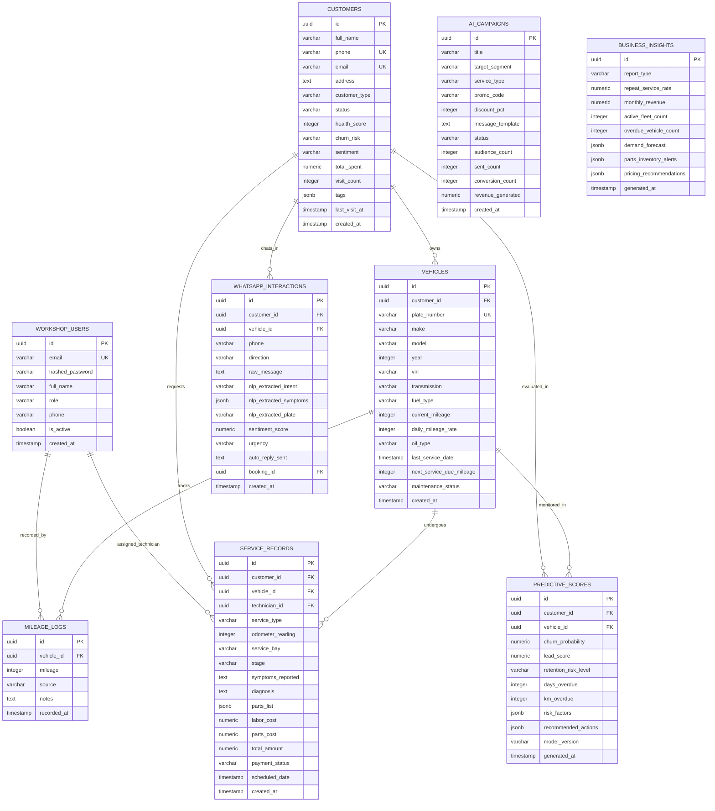

# SmartCRM — Database Schema & Architecture Design (Supabase PostgreSQL)
**CAT405 Intelligent Computing Major Project (Airiel Hazim Bin Redzuan Ng, Dr. Mohd Nadhir Ab Wahab — USM)**

---

## 1. Overview & Relational Design
SmartCRM leverages **Supabase-managed PostgreSQL 16** to manage relational records across automotive customers, multi-vehicle fleets, workshop work orders, and WhatsApp interaction histories. The schema enforces strict ACID referential integrity, Row-Level Security (RLS) policies, and indexing for low-latency searches.

---

## 2. Entity-Relationship Diagram (ERD)

---

## 3. Data Dictionary

### 3.1 `workshop_users`
Stores authenticated workshop personnel with Role-Based Access Control (`admin`, `pic`, `technician`).

| Column | Type | Constraints | Description |
| :--- | :--- | :--- | :--- |
| `id` | UUID | PRIMARY KEY, gen_random_uuid() | Staff unique identifier |
| `email` | VARCHAR(255) | UNIQUE, NOT NULL | Login email address |
| `hashed_password` | VARCHAR(255) | NOT NULL | Bcrypt hashed secret |
| `full_name` | VARCHAR(120) | NOT NULL | Name of workshop staff / PIC |
| `role` | VARCHAR(50) | NOT NULL, DEFAULT 'pic' | 'admin', 'pic', 'technician' |
| `phone` | VARCHAR(50) | NULL | Contact phone number |
| `is_active` | BOOLEAN | NOT NULL, DEFAULT TRUE | Status flag |
| `created_at` | TIMESTAMPTZ | NOT NULL, DEFAULT NOW() | Registration timestamp |

### 3.2 `customers`
Automotive client entities and fleet accounts linked to multiple vehicles.

| Column | Type | Constraints | Description |
| :--- | :--- | :--- | :--- |
| `id` | UUID | PRIMARY KEY, gen_random_uuid() | Customer entity ID |
| `full_name` | VARCHAR(120) | NOT NULL | Vehicle owner's full name |
| `phone` | VARCHAR(50) | UNIQUE, NOT NULL | Mobile number for WhatsApp messages |
| `email` | VARCHAR(255) | NULL | Customer email |
| `address` | TEXT | NULL | Customer residential / business address |
| `customer_type`| VARCHAR(30) | NOT NULL, DEFAULT 'Individual'| 'Individual', 'Fleet', 'VIP' |
| `status` | VARCHAR(50) | NOT NULL, DEFAULT 'Active' | 'Active', 'Due Soon', 'Overdue', 'Churned' |
| `health_score` | INTEGER | NOT NULL, DEFAULT 85 | Real-time health score (0–100) |
| `churn_risk` | VARCHAR(20) | NOT NULL, DEFAULT 'Low' | Risk classification (Low, Medium, High) |
| `sentiment` | VARCHAR(20) | NOT NULL, DEFAULT 'Positive' | Sentiment polarity |
| `total_spent` | NUMERIC(12,2)| NOT NULL, DEFAULT 0.00 | Cumulative workshop spending (MYR) |
| `visit_count` | INTEGER | NOT NULL, DEFAULT 1 | Total number of recorded visits |
| `tags` | JSONB | NOT NULL, DEFAULT '[]'::jsonb | Segment categorization tags |
| `last_visit_at`| TIMESTAMPTZ | NULL | Timestamp of latest service completion |

### 3.3 `vehicles`
Vehicle entities linked to customer records with maintenance interval tracking.

| Column | Type | Constraints | Description |
| :--- | :--- | :--- | :--- |
| `id` | UUID | PRIMARY KEY, gen_random_uuid() | Vehicle entity ID |
| `customer_id` | UUID | REFERENCES customers(id) CASCADE | Vehicle owner ID |
| `plate_number` | VARCHAR(30) | UNIQUE, NOT NULL | License plate (e.g. WXY 8821, PNG 4419)|
| `make` | VARCHAR(50) | NOT NULL | Manufacturer (Proton, Perodua, Honda, Toyota)|
| `model` | VARCHAR(80) | NOT NULL | Vehicle model (X50, Myvi, Civic, Vios) |
| `year` | INTEGER | NOT NULL | Year of manufacture |
| `vin` | VARCHAR(50) | NULL | Vehicle Identification Number |
| `current_mileage`| INTEGER | NOT NULL, DEFAULT 0 | Current odometer reading (km) |
| `last_service_date`| TIMESTAMPTZ| NULL | Date of previous service |
| `next_service_due_date`| TIMESTAMPTZ| NULL | Target interval date |
| `next_service_due_mileage`| INTEGER| NOT NULL, DEFAULT 5000 | Next service odometer threshold |
| `maintenance_status`| VARCHAR(30)| NOT NULL, DEFAULT 'On Track' | 'On Track', 'Due Soon', 'Overdue' |

### 3.4 `service_records`
Workshop tickets / work orders tracked across the 6 Kanban stages.

| Column | Type | Constraints | Description |
| :--- | :--- | :--- | :--- |
| `id` | UUID | PRIMARY KEY, gen_random_uuid() | Work order identifier |
| `customer_id` | UUID | REFERENCES customers(id) CASCADE | Associated account |
| `vehicle_id` | UUID | REFERENCES vehicles(id) CASCADE | Target vehicle |
| `technician_id`| UUID | REFERENCES workshop_users(id) | Assigned mechanic / technician |
| `service_type` | VARCHAR(100)| NOT NULL | Package (Oil Service, Brake Pads, Major 40k)|
| `service_bay` | VARCHAR(30) | NOT NULL, DEFAULT 'Bay 1' | 'Bay 1 (Engine)', 'Bay 2 (Brakes)', etc. |
| `stage` | VARCHAR(50) | NOT NULL, DEFAULT 'Scheduled' | 'Inquiry', 'Scheduled', 'In Progress', 'QC', 'Ready for Pickup', 'Invoiced' |
| `parts_cost` | NUMERIC(10,2)| NOT NULL, DEFAULT 160.00 | Cost of spare parts (MYR) |
| `labor_cost` | NUMERIC(10,2)| NOT NULL, DEFAULT 80.00 | Workshop labor charge (MYR) |
| `total_amount` | NUMERIC(10,2)| NOT NULL, DEFAULT 240.00 | Total billable price (MYR) |

---

## 4. Row-Level Security (RLS) Policies
- All tables enable RLS (`ALTER TABLE ... ENABLE ROW LEVEL SECURITY;`).
- Permissive policies for authenticated staff and service roles allow workshop management across desktop and mobile devices.
- `supabase_realtime` publication broadcasts table events for live shop-floor updates.
