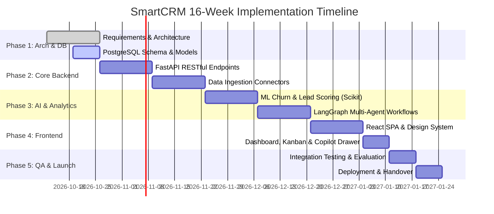

# SmartCRM — System Specification Document (Phase 1: Weeks 1–3)

## 1. Executive Summary
SmartCRM is an enterprise-grade Customer Relationship Management system integrating real-time customer analytics and agentic AI. It addresses modern B2B CRM challenges—specifically data fragmentation across channels, delayed churn intervention, and manual pipeline updates—by providing automated multi-agent reasoning, predictive machine learning, and an intuitive reactive dashboard.

---

## 2. User Roles & Access Control
SmartCRM implements Role-Based Access Control (RBAC):

| Role | Permissions & Responsibilities |
| :--- | :--- |
| **System Admin** | Global configuration, user management, audit log access, model threshold adjustments, API key management. |
| **Sales Manager** | Full visibility over team pipelines, quota forecasting, pipeline stage customisation, team performance analytics. |
| **Sales Representative** | Account management, deal execution, activity tracking, AI Copilot interaction, customer interaction logging. |
| **Customer Success** | Account health monitoring, churn risk escalation, customer support interaction logging, re-engagement task execution. |

---

## 3. Functional Requirements (FR)

### 3.1 Account & Customer Information Management (FR-1)
- **FR-1.1**: Maintain 360-degree customer records including company firmographics, contact details, tags, MRR, lifecycle stage, and health score.
- **FR-1.2**: Provide instant fuzzy searching, faceted filtering by industry, health tier (Good, Warning, Critical), and churn risk (Low, Medium, High).
- **FR-1.3**: Store complete audit trails for any status change or account attribute modification.

### 3.2 Multichannel Interaction Ingestion & Logging (FR-2)
- **FR-2.1**: Ingest incoming and outgoing interaction logs across email, live chat, call notes, and scheduled meetings.
- **FR-2.2**: Associate all communications directly with the customer entity and active deals.
- **FR-2.3**: Automatically compute sentiment scores (-1.0 to +1.0) and extract urgency flags upon ingestion.

### 3.3 Visual Sales Pipeline & Deal Tracking (FR-3)
- **FR-3.1**: Display visual Kanban pipeline across 6 canonical stages: *Lead*, *Qualified*, *Proposal*, *Negotiation*, *Closed Won*, and *Closed Lost*.
- **FR-3.2**: Allow real-time deal stage transitions with automated probability recalculation and audit timestamping.
- **FR-3.3**: Provide aggregate stage metrics (deal volume, weighted forecast value).

### 3.4 Predictive Analytics Engine (FR-4)
- **FR-4.1**: Compute **Lead Scoring** using Scikit-Learn regression/classification trained on engagement frequency, deal value, and company size.
- **FR-4.2**: Compute **Churn Risk Probability (0.0 to 1.0)** using a trained Gradient Boosting / Random Forest classifier evaluated on days since last touchpoint, recent sentiment velocity, and unresolved activity flags.
- **FR-4.3**: Expose top predictive risk factors (e.g., "Inactivity > 21 days", "Negative sentiment in last 2 interactions").

### 3.5 Agentic AI Orchestration & Sales Copilot (FR-5)
- **FR-5.1**: Autonomous background monitoring loop via **LangGraph** assessing customer states and generating prioritized action recommendations.
- **FR-5.2**: Provide one-click executable actions (e.g., auto-draft personalized re-engagement email, reschedule overdue touchpoint, trigger CS alert).
- **FR-5.3**: Natural language conversational copilot capable of querying CRM records, aggregating health insights, and triggering CRM actions via tool calls.

---

## 4. Non-Functional Requirements (NFR)

- **Performance**: Sub-150ms response latency for core REST API endpoints; sub-1.5s execution time for ML inference and LangGraph reasoning passes.
- **Security**: JWT-based stateless authentication, bcrypt password hashing, encrypted API secret storage, and SQL injection prevention via SQLAlchemy ORM.
- **Scalability**: Asynchronous non-blocking I/O using FastAPI and connection pooling for PostgreSQL.
- **Reliability & ACID Compliance**: Transactional integrity across deal and account updates using PostgreSQL transactions.
- **Usability**: Responsive React interface, dark luxury aesthetic, sub-1-second time-to-first-render, keyboard shortcuts, and responsive data views.

---

## 5. 16-Week Implementation Roadmap

